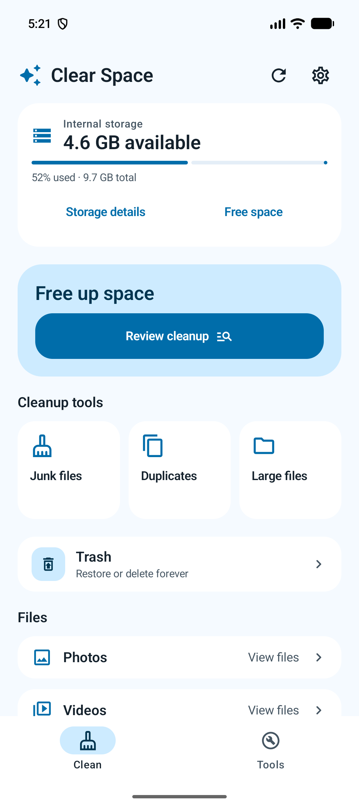
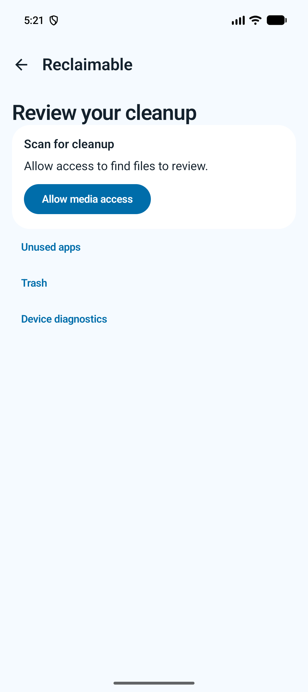
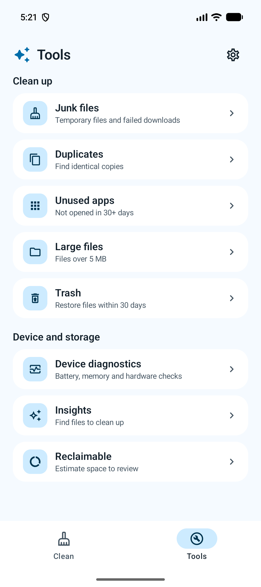
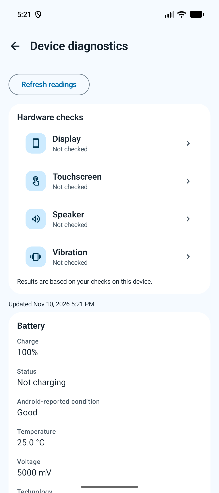
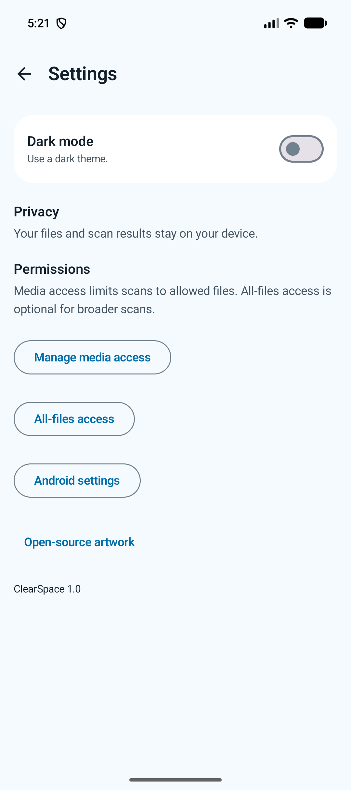
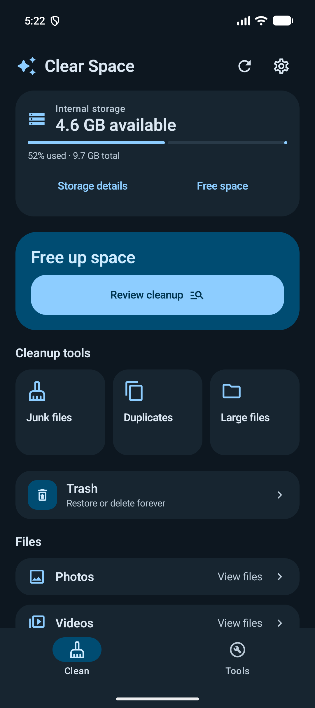

# ClearSpace

A clean, sky-blue Android app for reviewing storage, removing unwanted files and checking your device. Built with Kotlin and Jetpack Compose.

**On-device processing · No account · No internet permission · Light and dark themes**

[App walkthrough](#app-walkthrough) · [Features](#features) · [Installation](#installation) · [Architecture](#architecture) · [Testing](#testing)

## App Walkthrough

Screenshots from the current app running on the Pixel 10a emulator. Storage values and device readings vary.

<table>
  <tr>
    <th>Home</th>
    <th>Cleanup review</th>
    <th>Tools</th>
  </tr>
  <tr>
    <td></td>
    <td></td>
    <td></td>
  </tr>
  <tr>
    <th>Device diagnostics</th>
    <th>Settings</th>
    <th>Dark theme</th>
  </tr>
  <tr>
    <td></td>
    <td></td>
    <td></td>
  </tr>
</table>

## Features

- **Storage overview:** used and available space, with shortcuts to cleanup and file browsing.
- **Quick Scan:** refresh storage, memory and accessible media sizes; clear temporary ClearSpace cache.
- **Junk files:** review temporary files, incomplete downloads, thumbnails, installers and old copies.
- **Duplicates:** compare full file contents using SHA-256 and choose extra copies to remove.
- **Large files:** browse files over 5 MB, largest first.
- **Media browser:** review photos, videos and downloads; select files for cleanup.
- **Unused apps:** use optional usage access to find apps not opened recently and launch Android uninstall.
- **Insights and Reclaimable:** estimate space worth reviewing, counting overlapping candidates once.
- **Trash:** create a recovery copy before deleting an original, restore files, or confirm permanent deletion.
- **Device diagnostics:** view Android-reported battery, memory, storage, network, software and sensor information. Run guided display, touchscreen, speaker and vibration checks.
- **Settings:** saved dark-mode preference, permission controls and open-source artwork credits.

### Privacy and recovery

Files and scan results stay on your device. ClearSpace has no account, server or tracking SDK.

Media access controls which files appear in scans. All-files access is optional for broader junk scans; usage access is optional for app history. Android may ask for write consent before protected files can be removed.

Trash keeps recovery copies for up to **30 days**. These copies still use storage until removed. Uninstalling ClearSpace or clearing its data also removes recovery copies. Recovery files and the database are excluded from Android backup and device transfer.

Quick Scan clears only this app's temporary cache. Hardware check results reflect your observations; Android readings do not measure battery lifespan or prove sensor health.

## Technologies Used

| Area | Technology |
| --- | --- |
| Language | Kotlin |
| UI | Jetpack Compose, Material 3 |
| State and navigation | ViewModel, StateFlow, Navigation Compose |
| Dependency injection | Hilt |
| Local storage | Room, DataStore |
| Background work | Kotlin coroutines |
| Testing | JUnit, Compose UI tests, AndroidX Test, UI Automator |

## Installation

**Requirements:** Android Studio, JDK 21 for Gradle, Android SDK 36, and an Android 7.0+ device or emulator (API 24+). The Gradle wrapper uses version 9.2.1.

1. Clone the repository:

   ```sh
   git clone https://github.com/Sunil-V-Shetty/ClearSpace.git
   cd ClearSpace
   ```

2. Open the project in Android Studio and sync Gradle. Let Android Studio configure `local.properties` with your SDK location.
3. Select the `app` configuration and run on a device or emulator.

No API key or backend setup is needed. The first build downloads dependencies from Google Maven and Maven Central.

To build from the terminal:

```sh
./gradlew :app:assembleDebug
```

Debug APK: `app/build/outputs/apk/debug/app-debug.apk`.

## Usage

1. Open **Clean** to see storage and review cleanup suggestions.
2. Choose a tool or file category, then allow access when needed.
3. Review your selection before deleting. Use **Trash** to restore recovery copies or delete them forever.
4. Open **Tools → Device diagnostics** for readings and guided hardware checks.
5. Use **Settings → Dark mode** to change the theme.

## Architecture

The app uses three modules, with feature state flowing from platform readers and repositories through ViewModels to Compose screens.

| Module | Responsibility |
| --- | --- |
| `app` | App entry point, navigation, permission prompts, feature screens and ViewModels |
| `core` | Scanners, diagnostics readers, models, repositories, Room, preferences and platform helpers |
| `design` | Shared Compose components, Material 3 theme, typography and vector artwork |
| `buildSrc` | Shared build configuration and dependency helpers |

`app` depends on `core` and `design`; `design` depends on `core`. Library modules do not depend on `app`.

## Testing

Run unit tests, lint and both builds:

```sh
./gradlew :app:testDebugUnitTest :core:testDebugUnitTest :design:testDebugUnitTest lintDebug :app:assembleDebug :app:assembleRelease
```

With a device or emulator connected, run the instrumentation suite:

```sh
./gradlew :app:connectedDebugAndroidTest
```

**Last verified: November 10, 2026**, on the Pixel 10a emulator (API 37):

- 17 instrumentation tests and 13 unit tests passed, with no failures or skipped tests.
- Debug and unsigned release builds completed.
- App lint reported 0 errors and 48 warnings.

Coverage includes tool navigation, file categories, Quick Scan, theme persistence, guided hardware controls, canceled and failed cleanup, duplicate matching, and a full select → delete → Trash → restore journey with exact file-content verification.

**Before publishing:** test permissions and hardware on real phones, review lint warnings, and configure production signing. Emulator tests cannot verify physical speaker, vibrator, touch or battery behavior. The release build currently produces `app/build/outputs/apk/release/app-release-unsigned.apk`.

## Design and Artwork

The UI uses a shared Material 3 sky-blue theme, short labels and layouts that adapt to large text.

Layout references: [Fossify File Manager](https://github.com/FossifyOrg/File-Manager) and [Material Files](https://github.com/zhanghai/MaterialFiles). ClearSpace uses its own Compose implementation.

The launcher, splash and in-app mark adapt Google's Material icon artwork under Apache 2.0. See the [bundled artwork license](app/src/main/assets/licenses/material-icons.txt), also available in **Settings → Open-source artwork**.

## About

Created by **Sunil V**.

[GitHub](https://github.com/Sunil-V-Shetty) · [LinkedIn](https://www.linkedin.com/in/sunil-shetty-166395284)

For bugs or feature requests, [open an issue](https://github.com/Sunil-V-Shetty/ClearSpace/issues).
